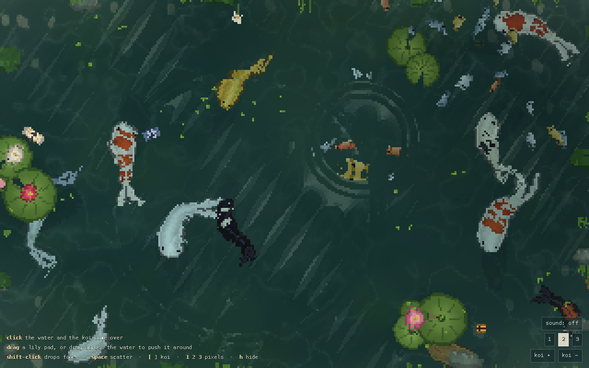

# pond

A pixel-art koi pond that runs in the browser. Raw WebGL 2, jQuery for the ripples, MIT licensed. No image files anywhere: every koi, pad, flower and butterfly is painted pixel by pixel at runtime.

The water fills the whole frame: no bank in view, just pond, with the floor shelving up toward the edges and the deep sitting under the middle. Leave it open and the koi drift around on their own, dipping to the cool and rising to the surface. Click the water and rings spread out, the fish turn and come over to look. Drag a lily pad across the surface and it pushes real waves, then settles back home.



## Run

Open `index.html`. That is the whole install: no build step, no dependencies to fetch, jQuery is vendored in `vendor/`. It works straight off the file system, and any static server will do just as well:

```
python3 -m http.server 4173
```

## Controls

- click or tap the water: a ripple, and the koi gather around it
- drag a lily pad, or drag across open water to shove it around
- shift-click: drops food pellets; the koi break off and go eat them
- `space` scatter · `[` `]` fewer or more koi · `1` `2` `3` pixel size
- `d` draw the procedural spines · `f` food at the middle · `h` hide the interface · `r` a brand new pond · `s` sound

## What lives in the pond

Ten nishikigoi looks, each drawn as its own fish rather than one shape recoloured: kohaku and sanke in bold red wraps with sumi spots, showa and shiro utsuri on black, bekko scattered with ink dots, tancho with a single clean crown, ogon and platinum in metal with a sheen down the back, asagi in a blue scale net with orange flanks, chagoi in olive with a fine net. Every pattern is painted when the fish spawns, so no two are identical, and tancho stays rare on purpose at one per pond. Schools of tiny minnows in four colours bolt when a koi passes overhead or a ring rolls through them. Butterflies wander the pond, find a flowering lily, circle it and land. Lily pads float in clusters with lotus flowers on some of them, mossy stones stand in the shallows toward the edges, reeds and grass lean in from just outside the frame, duckweed drifts across the middle, and cloud shadows sweep over everything. There is a sprite sheet at `docs/sprites.html` with all ten koi at 4x if you want to look at them closely.

## How it works

**Pixels.** The scene renders into a small buffer (your window divided by 4 pixels, so around 320 by 200) and the canvas is stretched back up with `image-rendering: pixelated`. Sprites are painted once on offscreen canvases, outlined, then alpha-hardened to 0 or 255 so nothing turns soft when the buffer is magnified. NEAREST sampling everywhere.

**Fish.** Each koi steers from a few small urges: its own slow wander, spacing from its neighbours, a loose pull toward company, the shoreline push, the last click, and food. Heading chases the blended result through angular velocity, so turns ease in and out, and the turn rate is capped by the fish's own length so the body can never fold back on itself. The body is a relaxed chain of 14 spine nodes that keeps its distances from the head down, with a travelling wave added toward the tail in the vertex shader. The sprite is bent by that chain through a silhouette table measured from the painted art, which means fins and tail fans survive any bend without being squashed. Deeper fish are drawn first and tinted by the water colour, shallower ones pass over the top.

**Water.** A calm analytic swell plus a handful of rings. Every ring is a jQuery job: a plain object animated from p=0 to p=1 by jQuery's own ticker, and the step callback turns that timeline into a radius and an amplitude. Because the ring lives on a timeline instead of a grid, it expands once and fades. There is no way for it to bounce off the frame and come back, which is what makes it feel like one calm ring instead of a sloshing tank. The finished frame is drawn through one refraction pass: the surface slope, built from the same analytic field, displaces the whole image by whole pixels, so everything under the surface bends with the waves the way a background bends under jquery.ripples. The plugin itself ripples a static element background and its wave field is private, so a live scene cannot ride it. The maths runs on our own buffers instead. Fish and pads ride the same field: they bob as a ring passes and drift away from the crest.

**Depth and light.** The pond floor is shaded by depth with caustics where the water is shallow, slow diagonal shafts of sunlight, and pebbles and algae. A bloom pass catches only the brightest pixels, so glints and flowers glow while the fish stay crisp, and cloud shadows drift over everything at the end.

## Tuning

Every knob is in `src/config.js`: koi counts and palettes, ripple profiles, water colours and refraction strength, caustics, clouds, scenery counts. Edit, reload.

## URL parameters

- `?seed=123` reseeds the whole pond (layout, patterns, sizes)
- `?koi=20` sets the koi count, `?px=3` the pixel size
- `?t=10` fast-forwards ten seconds before the first frame, handy with links and screenshots
- `?demo=1` runs a scripted sequence of ripples and a feeding

## Files

- `index.html`: the page, the HUD, the script tags (classic scripts, in order)
- `src/util.js`: seeded randomness, noise, small maths
- `src/config.js`: every knob
- `src/textures.js`: every sprite, painted pixel by pixel
- `src/pond.js`: the shoreline table shared by the CPU and the shaders
- `src/water.js`: the swell, the jelly ripple jobs, and the CPU side queries
- `src/world.js`: scenery layout, pads that ride the water, clouds
- `src/fish.js`: koi behaviour, spines, minnow schools, feeding
- `src/butterflies.js`
- `src/gfx.js`: shaders, render targets, the frame pipeline
- `src/main.js`: boot, input, the fixed-step loop, draw order

## Credits

Inspired by [nagomi](https://github.com/msk1039/nagomi), Mayank Kadam's procedural koi pond, and by the generative koi patterns on [arcade.pirillo.com](https://arcade.pirillo.com/koi-pond.html). Both were read for technique; no code or assets were taken. Independent implementation throughout.

## License

MIT, see LICENSE.
